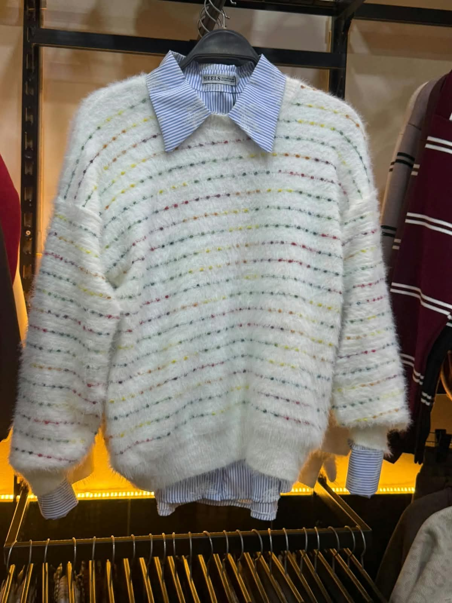
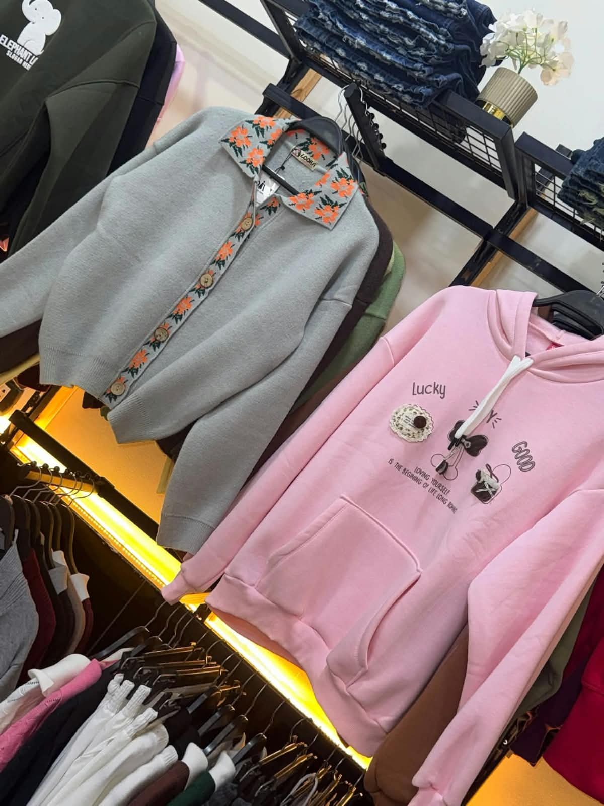

<div align="center">


# DIVA ✦ BE YOUR OWN STAR

**موقع متكامل لمحل ملابس حريمي في المنصورة — تصميم راقي، أنيميشن ناعم، ولوحة تحكم خاصة بصاحبة المحل.**

[](https://azmyehab21.github.io/DIVA-STOR/)
[](#-التقنيات)
[](#-التقنيات)
[](#-التقنيات)
[](#-لوحة-التحكم-admin)
[](https://azmyehab21.github.io/DIVA-STOR/)

[🌐 شوف الموقع](https://azmyehab21.github.io/DIVA-STOR/) ·
[🖼️ المعرض](https://azmyehab21.github.io/DIVA-STOR/gallery.html) ·
[🏷️ العروض](https://azmyehab21.github.io/DIVA-STOR/offers.html) ·
[📞 تواصل](https://azmyehab21.github.io/DIVA-STOR/contact.html)

<br />






</div>

---

## ✨ نبذة عن المشروع

**DIVA** هو الموقع الرسمي لمحل ملابس حريمي في **المنصورة — منية النصر**. الموقع مش مجرد صفحة تعريفية؛ هو واجهة كاملة بتعرض التشكيلات والعروض وبتخلي العميلة توصل للمحل بضغطة (واتساب، اتصال، خريطة)، ومعاه **لوحة تحكم خاصة** بتخلّي صاحبة المحل تضيف وتعدّل العروض والصور من غير ما تلمس سطر كود.

> الموقع مبني بـ **HTML + CSS + Vanilla JavaScript** بدون أي framework، واللوحة شغالة على **Supabase** (Auth + Postgres + Storage) — يعني خفيف جدًا، وسريع، واستضافته مجانية على GitHub Pages.

---

## 🎯 المميزات

### 🛍️ للزائرات
| | الميزة |
|---|---|
| 🌍 | **واجهة عربية بالكامل (RTL)** مع خطوط Cairo / Aref Ruqaa / Playfair Display |
| 🌓 | **وضع داكن / فاتح** بيتحفظ في المتصفح |
| 🖼️ | **معرض صور** بفلترة (كاجوال / سهرة / جديد) و **Lightbox** بالسحب والأسهم |
| 🎞️ | **Rail** أفقي بالسحب لأحدث الإطلالات |
| 🏷️ | **صفحة العروض** بتتحدّث لايف من قاعدة البيانات |
| 🕒 | **حالة المحل (مفتوح / مغلق)** لحظيًا بتوقيت القاهرة، مع مواعيد خاصة للجمعة |
| 💬 | **واتساب + اتصال + خريطة Google** بضغطة واحدة |
| ✉️ | **نموذج تواصل ونشرة بريدية** عن طريق EmailJS مع تحقق من المدخلات |
| ✨ | أنيميشن دخول للعناوين، تأثير Spotlight/Tilt على الكروت، مؤشر ماوس مخصص، شاشة تحميل |
| ♿ | رابط "تخطي إلى المحتوى"، `aria-*`، ودعم `prefers-reduced-motion` |
| 📱 | **Responsive** على الموبايل والتابلت والديسكتوب، وبيتثبّت كـ **PWA** (`site.webmanifest`) |


---

## 🧱 التقنيات

| الطبقة | الأدوات |
|---|---|
| **Frontend** | HTML5 · CSS3 (Custom Properties) · Vanilla JavaScript (بدون مكتبات) |
| **Backend as a Service** | [Supabase](https://supabase.com/) — Auth · PostgreSQL + RLS · Storage |
| **الرسائل** | [EmailJS](https://www.emailjs.com/) |
| **أيقونات وخطوط** | Font Awesome 6 · Google Fonts |
| **الاستضافة** | GitHub Pages |
| **SEO** | Open Graph · Twitter Card · JSON-LD (`ClothingStore`) · `sitemap.xml` · `robots.txt` · canonical |

---

## 📂 هيكلة المشروع

```text
DIVA-STOR/
├── index.html                  # الرئيسية
├── about.html                  # عن المحل
├── gallery.html                # المعرض + Lightbox
├── offers.html                 # العروض (ديناميكية من Supabase)
├── contact.html                # التواصل + الخريطة + النموذج
├── privacy.html                # سياسة الخصوصية
├── 404.html                    # صفحة الخطأ
│
├── admin-login.html            # دخول الإدارة (noindex)
├── admin.html                  # لوحة التحكم (noindex)
│
├── styles.css · globals.css    # التصميم والثيمات
├── admin.css                   # تصميم لوحة التحكم
├── script.js                   # التفاعلات والأنيميشن + EmailJS + حالة المحل
├── public-content.js           # تحميل العروض والصور العامة من Supabase
├── admin.js                    # منطق لوحة التحكم
├── supabase-config.js          # إعدادات الاتصال (URL + anon key)
│
├── supabase-schema.sql         # الجداول + سياسات RLS + Storage bucket
├── site-images-migration.sql   # جدول صور الموقع + استيراد العروض/الصور القديمة
│
├── images/products/            # صور الإطلالات (diva-look-01 … 14)
├── diva-new-photos/            # دفعة صور جديدة جاهزة للرفع من اللوحة
├── favicon-*.png · logo.png    # الهوية والأيقونات
├── site.webmanifest            # إعداد PWA
├── sitemap.xml · robots.txt    # SEO
├── ADMIN-SETUP.md              # دليل تفصيلي لإعداد لوحة التحكم
└── IMAGES-SETUP.md             # دليل إدارة الصور وقاعدة البيانات
```

---

## 🚀 التشغيل محليًا

مفيش build ولا dependencies — الموقع Static بالكامل.

```bash
# 1) نزّل المشروع
git clone https://github.com/AZMYEHAB21/DIVA-STOR.git
cd DIVA-STOR

# 2) شغّله بأي سيرفر محلي (اختار واحد)
python3 -m http.server 8000
# أو
npx serve .
```

وافتح 👉 `http://localhost:8000`

> ⚠️ **ملاحظة:** العروض والصور الديناميكية بتتحمّل من Supabase، فلازم يكون فيه اتصال بالإنترنت وإعدادات `supabase-config.js` صحيحة. لو الاتصال فشل، الموقع بيعرض رسالة حالة واضحة بدل ما يعرض بيانات قديمة على إنها محدثة.

---

## 🔐 لوحة التحكم (Admin)

اللوحة في `admin-login.html` → `admin.html`، والحماية الحقيقية فيها مش "إخفاء الرابط" — هي **Supabase Auth + Row Level Security**.

### الإعداد لمرة واحدة

1. أنشئ مشروع على [Supabase](https://supabase.com/).
2. من **Project Settings → API** انسخ `Project URL` و `anon/public key` وحطهم في `supabase-config.js`:
   ```js
   window.DIVA_SUPABASE = {
     url: "https://YOUR-PROJECT.supabase.co",
     anonKey: "YOUR_ANON_PUBLIC_KEY",
     adminEmail: "admin@example.com"
   };
   ```
3. من **SQL Editor** شغّل `supabase-schema.sql` بالكامل.
4. شغّل بعده `site-images-migration.sql` (آمن لإعادة التشغيل ومش بيكرر البيانات).
5. من **Authentication → Users** أنشئ مستخدم الإدارة بنفس `adminEmail` وكلمة مرور قوية.
6. انسخ **User UID** وضيفه في جدول الأدمن:
   ```sql
   insert into public.diva_admins (user_id) values ('USER-UUID-HERE');
   ```
7. ارفع المشروع على GitHub Pages، وافتح `admin-login.html` وسجّل دخول.

### قاعدة البيانات

| الجدول / الـ Bucket | الغرض |
|---|---|
| `diva_offers` | العروض (عنوان، وصف، شارة، تاريخ، أيقونة، حالة، ترتيب) |
| `diva_site_images` | كل صور الموقع (الرئيسية + المعرض) بتصنيفاتها ومواضع ظهورها |
| `diva_gallery` | جدول المعرض الأصلي |
| `diva_settings` | إعدادات الصفحة الرئيسية (عنوان / وصف / صورة) |
| `diva_admins` | المستخدمون المسموح لهم بالإدارة |
| `storage: diva-media` | تخزين الصور المرفوعة |

### 🛡️ الأمان

- القراءة العامة مسموحة **للمحتوى النشط فقط** (`active = true`).
- الكتابة والتعديل والحذف **للأدمن فقط** عبر سياسات RLS تتحقق من `diva_admins`.
- ❌ **ممنوع** وضع `service_role` key في أي ملف JavaScript.
- ❌ **ممنوع** تخزين كلمة مرور الإدارة في الكود أو `localStorage`.
- حذف الصورة بيمسح ملف الـ Storage الأول، ولو فشل بيوقف ومش بيحذف السجل.
- صفحات الإدارة عليها `noindex, nofollow` ومش بتظهر في Google.

📖 تفاصيل أكتر في [`ADMIN-SETUP.md`](ADMIN-SETUP.md) و [`IMAGES-SETUP.md`](IMAGES-SETUP.md).

---

## ⚙️ التخصيص السريع

كل الإعدادات القابلة للتعديل في أول `script.js`:

```js
let OFFERS_AVAILABLE = true;                 // إظهار / إخفاء قسم العروض
const WHATSAPP_NUMBER = '201142640064';      // رقم واتساب المحل
const STORE_HOURS = { default: [10, 22], 5: [14, 22] };  // مواعيد العمل (5 = الجمعة)
const EMAILJS = { publicKey, serviceId, templateId };    // بيانات EmailJS
```

لربط عناصر الصفحة الرئيسية بلوحة التحكم استخدم الـ attributes دي:

| Attribute | بيتحكم في |
|---|---|
| `data-cms-hero-title` | عنوان الواجهة |
| `data-cms-hero-subtitle` | وصف الواجهة |
| `data-cms-hero-image` | صورة الواجهة (على ``) |
| `data-site-image="key"` | أي صورة مرتبطة بمفتاح في `diva_site_images` |

---

## 🔍 SEO والأداء

- `lang="ar"` و `dir="rtl"` على كل الصفحات.
- Meta description و Open Graph و Twitter Card و canonical لكل صفحة.
- **Structured Data (JSON-LD)** من نوع `ClothingStore` عشان Google يفهم إنه محل ملابس بمكان محدد.
- `sitemap.xml` و `robots.txt` وملف التحقق من Google Search Console.
- `preconnect` للخطوط، وبدون أي framework ثقيل — كله Vanilla JS.

---

## 📍 معلومات المحل

| | |
|---|---|
| 📌 **العنوان** | المنصورة — منية النصر، شارع المحكمة |
| 🕙 **المواعيد** | السبت – الخميس: 10 ص – 10 م · الجمعة: 2 م – 10 م |
| 📱 **واتساب / هاتف** | [01142640064](https://wa.me/201142640064) |
| 📸 **Instagram** | [@diva.stor5](https://www.instagram.com/diva.stor5) |
| 🎵 **TikTok** | [@diva.store394](https://www.tiktok.com/@diva.store394) |
| 👍 **Facebook** | [DIVA على فيسبوك](https://www.facebook.com/share/14aCKS9BwPQ/) |

---

## 🗺️ Roadmap

- [x] واجهة عربية RTL مع وضع داكن
- [x] معرض صور بفلترة و Lightbox
- [x] لوحة تحكم آمنة (Supabase Auth + RLS)
- [x] رفع وإدارة الصور من اللوحة
- [x] SEO + PWA manifest
- [ ] Service Worker للعمل Offline
- [ ] تحويل الصور تلقائيًا إلى WebP عند الرفع
- [ ] صفحة منتج مع سلة طلب عبر واتساب
- [ ] نسخة إنجليزية من الموقع

---

## 🤝 المساهمة

```bash
git checkout -b feature/my-feature
git commit -m "feat: add my feature"
git push origin feature/my-feature
# وبعدين افتح Pull Request
```

---

## 👨‍💻 المطور

**عزمي إيهاب — Azmy Ehab**
Junior Web / Backend Developer

[](https://github.com/AZMYEHAB21)
[](mailto:azmyehab610@gmail.com)
[](https://azmyehab.cc)

---

<div align="center">

لو المشروع عجبك، ساعدنا بنجمة ⭐ على GitHub

**DIVA ✦ BE YOUR OWN STAR**

</div>
